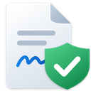
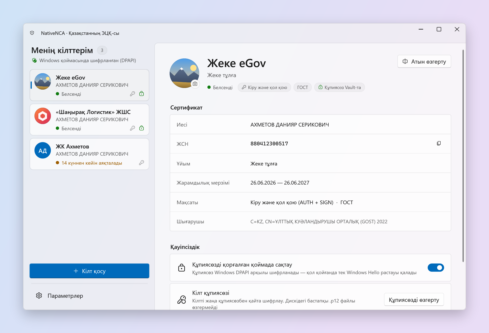
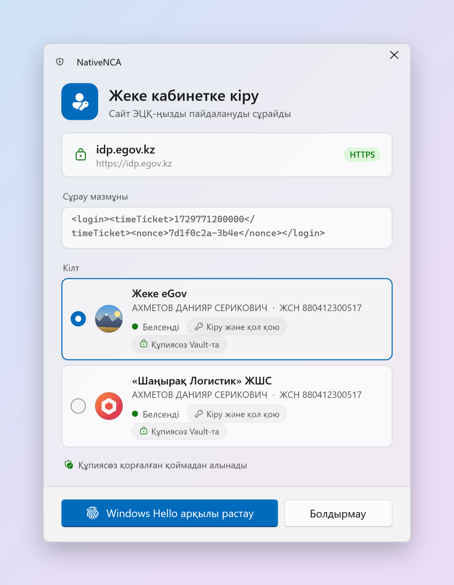
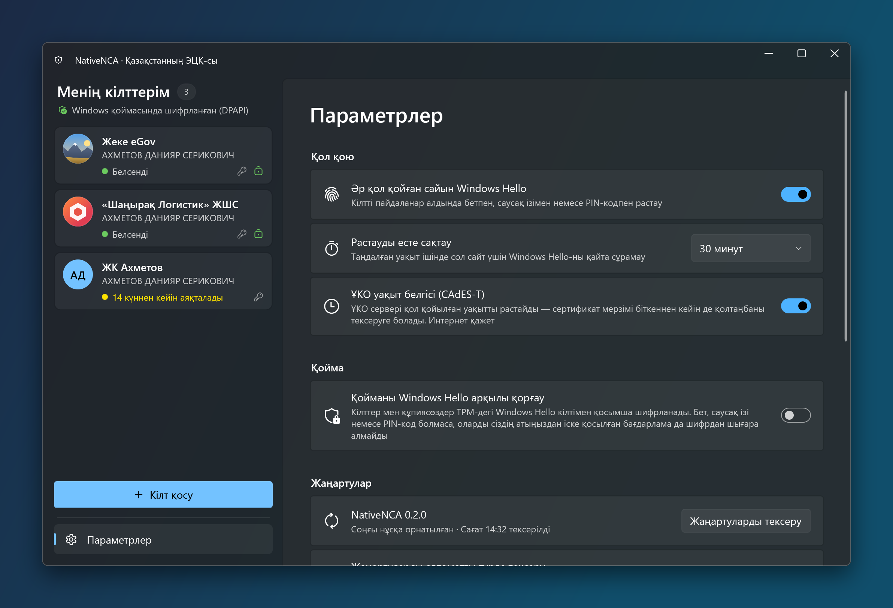
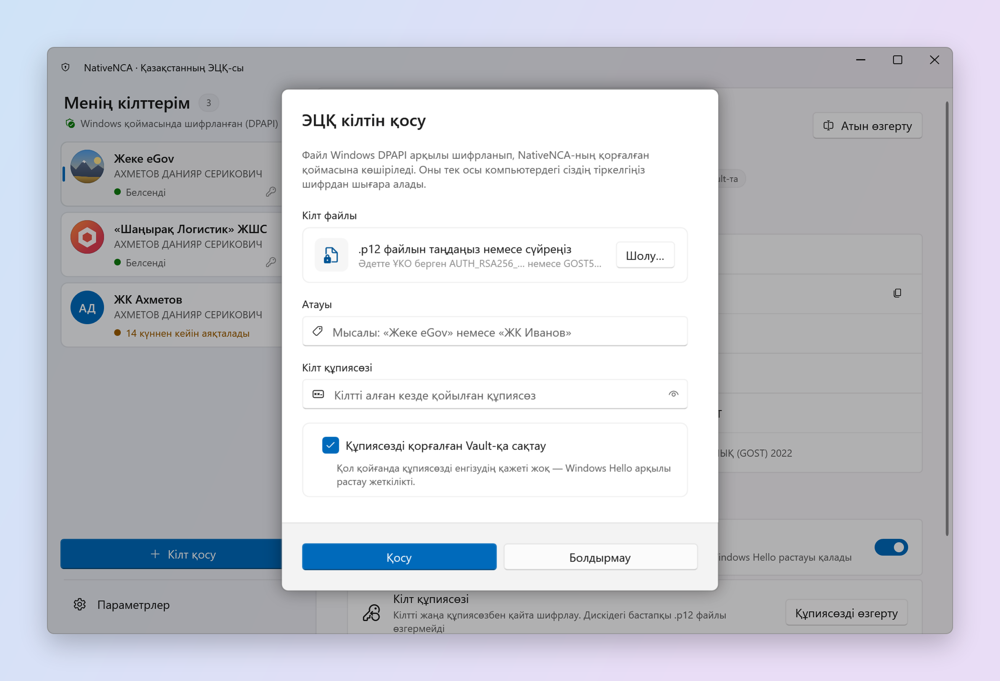

# NativeNCA

[English](README.md) | [Русский](README.ru.md) | **Қазақша**

NativeNCA — Windows жүйесіне арналған NCALayer-дің нативті баламасы. Ол арқылы ҰКО (НУЦ РК) берген ЭЦҚ кілтімен eGov-қа, интернет-банктерге және басқа да қазақстандық сервистерге кіріп, құжаттарға қол қоюға болады. Java қажет емес, кілттің құпиясөзін әр жолы енгізудің де қажеті жоқ.

Сайттар NativeNCA-мен NCALayer-мен қалай байланысса, дәл солай байланысады, сондықтан олар тарапынан ештеңе өзгертудің керегі жоқ. `.p12` кілттеріңізді бір рет қосасыз, одан кейін әр сұрауда түсінікті растау терезесі шығады: қай сайт сұрап тұр, нені қол қойғысы келеді және қай кілт қолданылады. Windows Hello арқылы растайсыз.

<picture>
  <source media="(prefers-color-scheme: dark)" srcset="docs/screenshots/kk/main-dark.png">
  
</picture>

## Тағы бір NCALayer не үшін керек

NCALayer өз міндетін атқарады, бірақ ол Java қосымшасы: ұзақ іске қосылады, жадта JVM ұстайды, әр операция сайын кілт файлын таңдап, құпиясөзді енгізуді сұрайды және заманауи Windows-та бөтен көрінеді. NativeNCA — шағын .NET қосымшасы. Ол науада тұрады, лезде іске қосылады және кілттерді шифрланған қоймада сақтайды. Осылайша қол қою бір шерту мен саусақ тигізуге айналады.

## Мүмкіндіктер

- **NCALayer-мен үйлесімді.** `wss://127.0.0.1:13579` мекенжайын тыңдайды және `kz.gov.pki.knca.commonUtils` пен `kz.gov.pki.knca.basics` модульдерін іске асырады: CMS/CAdES және XML қолтаңбалары, бірнеше құжатқа бірден қол қою, сертификат туралы мәліметтер.
- **ҰКО-ның ГОСТ және RSA кілттері.** ҚР ҰКО берген ҚР СТ ГОСТ Р 34.10-2015 (512 бит) және RSA кілттері қолдау табады. Криптография BouncyCastle негізінде басқарылатын кодпен жазылған және ҰКО-ның өз Kalkan кітапханасы жасаған қолтаңбалармен салыстырылып тексерілген. Kalkan SDK мен Java қажет емес.
- **Кілттер қоймасы.** Кілттер және қаласаңыз олардың құпиясөздері Windows DPAPI арқылы шифрланып сақталады. Кілттерге түсінікті атау беруге («Жеке eGov», «Шаңырақ ЖШС») және құпиясөзін ауыстыруға болады.
- **Кілт суреттері.** Әр кілтке фото немесе компания логотипін қойып, оны қосымшаның ішінде кесуге болады. Сонда керекті кілт тізімде де, қол қою терезесінде де бірден көрінеді.
- **Windows Hello.** Әр қолтаңба бет-әлпетті, саусақ ізін немесе PIN-кодты талап ете алады. Қосымша қорғалған режимде қойманың өзі TPM-дегі Windows Hello кілтімен шифрланады: сізсіз кілттерді сіздің атыңыздан іске қосылған бағдарлама да аша алмайды.
- **Уақыт белгілері.** CMS қолтаңбаларына ҰКО қызметінен сенімді уақыт белгісін (CAdES-T) қосуға болады. Сонда сертификаттың мерзімі біткеннен кейін де қолтаңбаны тексеруге болады.
- **Windows 11 үшін жасалған.** Fluent Design, Mica, ашық және күңгірт тақырыптар, науадағы белгіше, Windows-пен бірге іске қосылу.
- **Қазақша, орысша және ағылшынша.** Тіл Windows бойынша таңдалады (қазақ және орыс тіліндегі Windows-та — сол тіл, қалған жағдайда ағылшын тілі) немесе параметрлерде таңдауға болады. Тіл қайта іске қоспай-ақ бірден ауысады.

<table>
  <tr>
    <td width="40%"></td>
    <td width="60%"><br></td>
  </tr>
</table>

## Талаптар

- Windows 10 2004 нұсқасы немесе жаңарағы, не Windows 11 (x64 немесе ARM64).
- NCALayer қажет емес. Егер ол орнатылған болса, оны NativeNCA-мен бір мезгілде іске қосуға болмайды: сайттар екі бағдарламаны да бір портта күтеді. NCALayer іске қосулы болса, NativeNCA оны жабуды және автоматты іске қосылуын өшіруді ұсынады.
- Windows Hello (PIN-код, саусақ ізі немесе бет-әлпет) ұсынылады, бірақ міндетті емес.

## Бастау

1. [Releases](../../releases) бетінен процессорыңызға арналған мұрағатты жүктеп (`win-x64` көп компьютерге сай келеді, `win-arm64` — ARM үшін), оны шығарыңыз.
2. `NativeNCA.exe` іске қосып, **Орнату** батырмасын басыңыз. NativeNCA әкімші құқығынсыз, тек сіздің есептік жазбаңыз үшін `%LOCALAPPDATA%\Programs\NativeNCA` қалтасына орнатылады және «Бастау» мәзірі мен орнатылған қолданбалар тізімінде пайда болады. **Орнатпай іске қосу** бағдарламаны ағымдағы қалтадан іске қосады, бірақ мұндай көшірме өздігінен жаңармайды.
3. Алғаш іске қосқанда бағдарлама браузерлерге арналған сертификат не үшін керек екенін түсіндіріп, оны орнатады. Windows сертификат орнату туралы қауіпсіздік ескертуін бір рет көрсетеді — **Иә** деп жауап беріңіз. NativeNCA науада пайда болып, сайттардың сұрауларын қабылдай бастайды.
4. **Кілт қосу** батырмасын басып, ҰКО берген `.p12` файлын таңдаңыз, құпиясөзді енгізіп, кілтке атау беріңіз. Тек Windows Hello арқылы қол қойғыңыз келсе, **Құпиясөзді қорғалған Vault-қа сақтау** параметрін қосулы қалдырыңыз.
5. eGov-ты немесе банкіңізді ашып, әдеттегідей кіріңіз. NCALayer орнына NativeNCA растау терезесі шығады.

## Жаңарту және жою

- Орнатылған NativeNCA іске қосылғанда және әр алты сағат сайын GitHub-тан жаңа нұсқаны тексереді. Мұны параметрлердің **Жаңартулар** бөлімінде өшіруге болады. Жаңа нұсқа шыққанда терезеде баннер пайда болады, ал Windows әр нұсқа туралы бір рет хабарлама көрсетеді. **Жаңарту** батырмасы мұрағатты жүктеп, тексереді де, NativeNCA-ны бірнеше секундта қайта іске қосады. Кілттер мен параметрлер сақталады.
- Әр релиз мұрағатына жоба кілтімен қол қойылған. NativeNCA жаңартуды қолтаңба дәл осы нұсқа мен процессор архитектурасы үшін жарамды болса және нұсқа орнатылғаннан жаңа болса ғана орнатады. Қалғанының бәрі қабылданбайды. Файлдар тек github.com-нан HTTPS арқылы жүктеледі.
- Алдыңғы нұсқа сақталады. Жаңартудан кейін бірдеңе дұрыс жұмыс істемей қалса, параметрлерде **Алдыңғы нұсқаны қайтару** батырмасын басыңыз. Сіз қайтып келген нұсқа енді автоматты түрде ұсынылмайды, бірақ оны **Жаңартуларды тексеру** батырмасы табады.
- Бағдарламаны NativeNCA параметрлерінен (**NativeNCA-ны жою**) немесе «Windows параметрлері → Қолданбалар → Орнатылған қолданбалар» арқылы жоюға болады. Әдепкіде кілттер мен параметрлер қайта орнатқан жағдайға арнап `%APPDATA%\NativeNCA` қалтасында қалады; оларды браузерлерге арналған сертификатпен бірге жою үшін құсбелгі қойыңыз. Бастапқы `.p12` файлдары өзгермейді.

## Қалай жұмыс істейді

Сайт қолтаңба сұрағанда, NativeNCA доменді, қол қойылатын деректерді және сұрауға сәйкес келетін кілттерді көрсетеді. Растағаннан кейін кілт жадта ашылады, деректерге сіздің компьютеріңізде қол қойылады, ал сайтқа тек қолтаңба мен ашық сертификатыңыз жіберіледі. Жабық кілт компьютерден шықпайды.

Сақтау:

- Кілт файлдары мен сақталған құпиясөздер Windows тіркелгіңізге арналған DPAPI арқылы шифрланып, `%APPDATA%\NativeNCA\Vault` қалтасында сақталады.
- Windows Hello қорғауы қосылғанда олар қосымша AES-256-GCM арқылы шифрланады. Қойма кілті тек Windows Hello аша алатын Microsoft Passport қоймасындағы RSA кілтімен шифрланған. Бір тексеру қойманы параметрлерде көрсетілген уақытқа ашады.
- Windows PIN-кодын қалпына келтірсеңіз, Windows Hello кілті жойылады және қорғалған деректерді қалпына келтіру мүмкін болмайды. Бастапқы `.p12` файлдары мен олардың құпиясөздерін сақтап қойыңыз.

Браузерлерге арналған сертификат:

- Сайттар `wss://127.0.0.1:13579` мекенжайына TLS арқылы қосылады, сондықтан браузер жергілікті сертификатқа сенуі керек. NativeNCA компьютеріңізге арналған жеке куәландырушы орталық жасайды, ол арқылы `127.0.0.1` және `localhost` үшін бір рет сертификат шығарады да, оның жабық кілтін бірден жояды. Windows-тың сенімді түбірлік сертификаттарына тек ашық бөлігі қосылады, сондықтан ол басқа ештеңені растай алмайды. Оған қоса түбірлік сертификатта тек жергілікті мекенжайларға рұқсат беретін атау шектеулері жазылған.
- Сервер сертификаты мен оның кілті DPAPI арқылы шифрланып, `%APPDATA%\NativeNCA\Tls` қалтасында сақталады. Chrome, Edge және Firefox сертификаттарды Windows қоймасынан алады, сондықтан браузерлерді баптаудың қажеті жоқ. Firefox бұл қойманы тек іске қосылғанда оқиды: орнату кезінде ол ашық болса, оны қайта іске қосыңыз.
- Сертификатты параметрлердегі **Браузерлерге арналған сертификат** жолында жоюға болады. Ол орнатылғанға дейін, NCALayer орнатылған болса, NativeNCA соның сертификатын пайдаланады. Бұл сертификаттың жабық кілті барлық компьютерде бірдей, сондықтан NativeNCA өз сертификатын артық көреді.

## Шектеулер

- Аппараттық тасымалдағыштар мен жеке куәліктер (Kaztoken, eToken, JaCarta, ID-карта) әзірге қолдау таппайды. Тек `.p12` файл кілттері.
- Ескі ГОСТ 34.310-2004 кілттері қолдау таппайды. ҰКО оларды 2024 жылы шығаруды тоқтатты, және мұндай кілттердің барлығының мерзімі өтіп кеткен.
- `createCMSSignatureFromFile` арқылы дискідегі файлдарға қол қою қолдау таппайды. Әдетте сайттар деректерді тікелей жібереді.

## Бастапқы кодтан құрастыру

[.NET 10 SDK](https://dotnet.microsoft.com/download) қажет.

```
dotnet build
dotnet test --filter "Category!=Network"
dotnet publish NativeNCA.App -c Release -r win-x64 --self-contained -p:PublishSingleFile=true -o publish
```

Репозиторийде үш жоба бар:

| Жоба | Мақсаты |
| --- | --- |
| `NativeNCA.Core` | Криптография (PKCS#12, ГОСТ 2015, CMS, XMLDSig, уақыт белгілері), кілттер қоймасы, NCALayer хаттамасы және WebSocket сервері |
| `NativeNCA.App` | WPF және WPF-UI негізіндегі интерфейс |
| `NativeNCA.Tests` | Тесттер, соның ішінде ҰКО-ның нақты қолтаңбасымен тексеру |

Релиздерді GitHub Actions құрастырады. `v1.2.0` сияқты тег жіберілгенде тесттер іске қосылады, x64 және ARM64 үшін дербес пакеттер құрастырылып, GitHub релизі ретінде жарияланады.

Релиз мұрағаттарына ECDSA P-256 кілтімен қол қойылады. Оның ашық бөлігі `NativeNCA.Core` ішіне (`ReleaseSignature`) енгізілген, ал жабық бөлігі `RELEASE_SIGNING_KEY` репозиторий құпиясында сақталады; онсыз тегті құрастыру қатемен аяқталады. `tools/ReleaseSigning` утилитасы кілттер жұбын жасайды, сондай-ақ мұрағатқа жергілікті түрде қол қояды және оны тексереді.

## Жауапкершіліктен бас тарту

NativeNCA — тәуелсіз жоба. Ол Қазақстан Республикасының Ұлттық куәландырушы орталығымен және «Ұлттық ақпараттық технологиялар» АҚ-мен байланысты емес, олар мақұлдамаған және сертификаттамаған. Бағдарлама ақпаратты криптографиялық қорғаудың сертификатталған құралы болып табылмайды. Оны өз тәуекеліңізбен пайдаланыңыз және қандай да бір сервис қолтаңбаны қабылдамаса, NCALayer-ді қолыңызда ұстаңыз.
