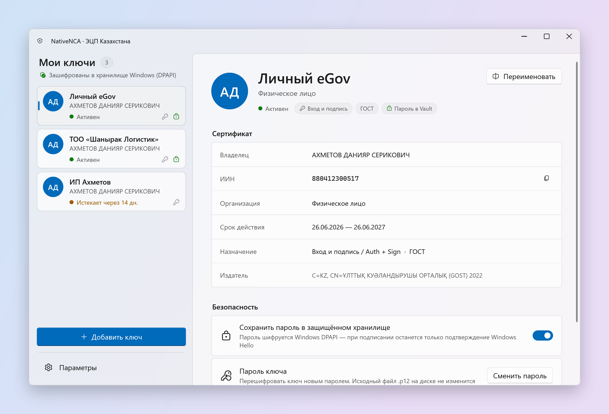
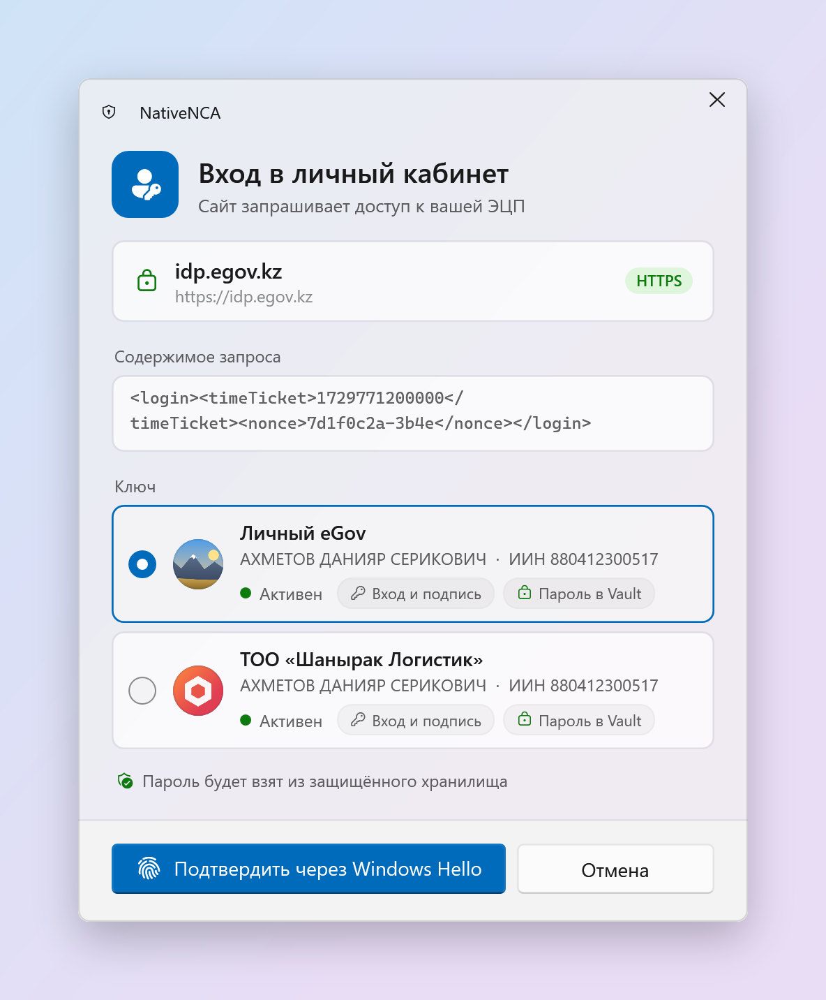
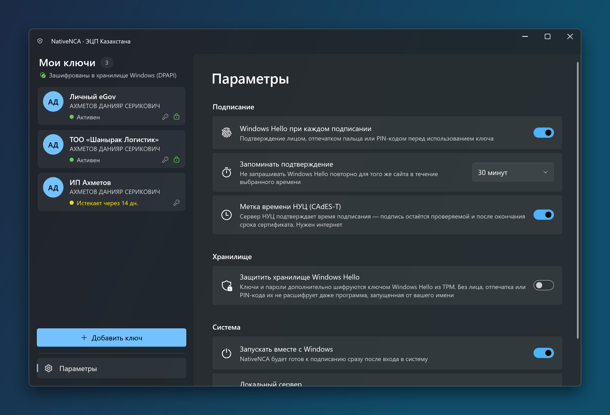
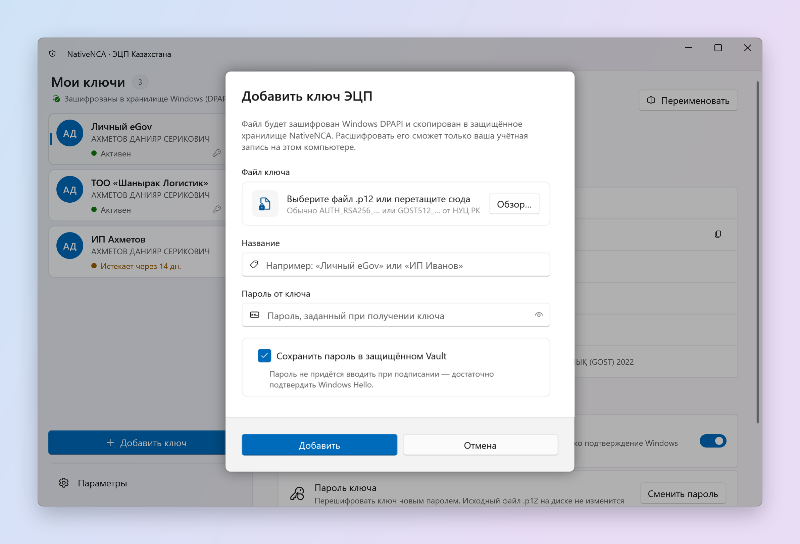

# NativeNCA

**English** | [Русский](README.ru.md) | [Қазақша](README.kk.md)

NativeNCA is a native Windows replacement for NCALayer. It lets you log in and sign documents on eGov, in online banking and in other Kazakh services with your NCA (НУЦ РК) digital signature, without Java and without typing your key password every time.

Websites talk to it exactly as they talk to NCALayer, so nothing has to change on their side. You add your `.p12` keys once, and from then on every request shows a clear confirmation window: which site is asking, what it wants to sign, and which key will be used. You approve with Windows Hello.

<picture>
  <source media="(prefers-color-scheme: dark)" srcset="docs/screenshots/main-dark.png">
  
</picture>

## Why another NCALayer

NCALayer does its job, but it is a Java application: it takes a while to start, keeps a JVM in memory, asks for the key file and password on every operation and looks out of place on a modern Windows desktop. NativeNCA is a small .NET application that sits in the tray, starts instantly and keeps your keys in an encrypted vault, so signing becomes one click and a fingerprint.

## Features

- **Compatible with NCALayer.** Listens on `wss://127.0.0.1:13579` and implements the `kz.gov.pki.knca.commonUtils` and `kz.gov.pki.knca.basics` modules: CMS/CAdES and XML signatures, multiple documents at once, certificate info.
- **GOST and RSA keys from NCA.** СТ РК ГОСТ Р 34.10-2015 (512 bit) and RSA keys issued by НУЦ РК. The cryptography is implemented in managed code on top of BouncyCastle and checked against signatures produced by NCA's own Kalkan library. No Kalkan SDK, no Java.
- **Key vault.** Keys and, if you choose, their passwords are stored encrypted with Windows DPAPI. You can give each key a readable name ("Personal eGov", "LLP Shanyrak") and change its password.
- **Key pictures.** Give each key a photo or a company logo, cropped right in the app, so the right key is easy to spot in the list and in the signing prompt.
- **Windows Hello.** Every signature can require face, fingerprint or PIN. In the optional protected mode, the vault itself is encrypted with a Windows Hello key kept in the TPM, so the keys cannot be decrypted without you, even by a program running under your account.
- **Timestamps.** CMS signatures can carry a trusted timestamp from the NCA time-stamping service (CAdES-T), so they remain verifiable after the certificate expires.
- **Built for Windows 11.** Fluent design, Mica, light and dark themes, tray icon, start with Windows.

<table>
  <tr>
    <td width="40%"></td>
    <td width="60%"><br></td>
  </tr>
</table>

## Requirements

- Windows 10 version 2004 or later, or Windows 11 (x64 or ARM64).
- NCALayer is not needed. If it is installed, it must not run at the same time as NativeNCA: websites expect both programs on the same port. When NCALayer is running, NativeNCA offers to close it and turn off its autostart.
- Windows Hello (PIN, fingerprint or face) is recommended but not required.

## Getting started

1. Download the latest archive for your processor from [Releases](../../releases) (`win-x64` fits most computers, `win-arm64` is for ARM) and extract it.
2. Run `NativeNCA.exe` and click **Install**. NativeNCA is installed for your Windows account only, without administrator rights, into `%LOCALAPPDATA%\Programs\NativeNCA`, and appears in the Start menu and in Installed apps. **Run without installing** starts it from the current folder instead, but such a copy does not update itself.
3. On the first start NativeNCA explains and sets up its certificate for browsers. Windows then shows a security warning about installing a certificate once; answer **Yes**. NativeNCA appears in the tray and starts listening for websites.
4. Click **Add key**, choose your `.p12` file from NCA, enter its password and give the key a name. Leave **Save password** on if you want to sign with Windows Hello alone.
5. Open eGov or your bank and sign in as usual. NativeNCA shows a confirmation window instead of NCALayer.

## Updates and uninstalling

- The installed NativeNCA checks GitHub for a new version at startup and every six hours. You can turn this off in Settings, under **Updates**. When a new version is out, a banner appears in the window and Windows shows a notification once per version. **Update** downloads the archive, checks it and restarts NativeNCA within a few seconds. Keys and settings are kept.
- Every release archive is signed with the project's release key. NativeNCA installs an update only if the signature is valid for exactly that version and processor architecture and the version is newer than the installed one; anything else is refused. Files are downloaded only from github.com over HTTPS.
- The previous version is kept. If something stops working after an update, click **Roll back to the previous version** in Settings. The version you rolled back from is not offered automatically again, but **Check for updates** still finds it.
- To uninstall, use **Uninstall NativeNCA** in Settings, or Windows Settings → Apps → Installed apps. By default your keys and settings stay in `%APPDATA%\NativeNCA` in case you install NativeNCA again; tick the box to delete them together with the browser certificate. Your original `.p12` files are never touched.

## How it works

When a website asks for a signature, NativeNCA shows the requesting domain, the data and the keys that fit the request. After you confirm, the key is decrypted in memory, the data is signed locally and only the signature and your public certificate are sent back to the website. The private key never leaves your computer.

Storage:

- Key files and saved passwords are encrypted with DPAPI for your Windows account and stored in `%APPDATA%\NativeNCA\Vault`.
- With Windows Hello protection turned on, they are additionally encrypted with AES-256-GCM. The vault key is wrapped by an RSA key in the Microsoft Passport key storage provider, which only Windows Hello can unlock. One verification opens the vault for the time set in Settings.
- If you reset your Windows PIN, the Windows Hello key is lost and protected data cannot be recovered. Keep your original `.p12` files and passwords.

Browser certificate:

- Websites connect to `wss://127.0.0.1:13579` over TLS, so the browser has to trust the local certificate. NativeNCA creates its own certificate authority for your computer, uses it once to issue a certificate for `127.0.0.1` and `localhost`, and destroys its private key right away. Only the public root certificate is added to your Windows trusted roots, so it can never vouch for anything else. On top of that, the root carries name constraints that limit it to local addresses.
- The server certificate and its key are encrypted with DPAPI and stored in `%APPDATA%\NativeNCA\Tls`. Chrome, Edge and Firefox use the Windows certificate store, so no browser settings are needed. Firefox reads it only at startup: if it was open during setup, restart it.
- You can remove the certificate in Settings, under **Browser certificate**. Until you set it up, NativeNCA falls back to NCALayer's certificate if NCALayer is installed. That certificate's private key is the same on every computer, which is why NativeNCA prefers its own.

## Limitations

- Hardware tokens and ID cards (Kaztoken, eToken, JaCarta, ID card) are not supported yet. Only file keys (`.p12`).
- Legacy GOST 34.310-2004 keys are not supported. NCA stopped issuing them in 2024, and all of them have expired.
- Signing local files through `createCMSSignatureFromFile` is not supported. Websites normally send data directly.

## Building from source

You need the [.NET 10 SDK](https://dotnet.microsoft.com/download).

```
dotnet build
dotnet test --filter "Category!=Network"
dotnet publish NativeNCA.App -c Release -r win-x64 --self-contained -p:PublishSingleFile=true -o publish
```

The repository contains three projects:

| Project | Purpose |
| --- | --- |
| `NativeNCA.Core` | Cryptography (PKCS#12, GOST 2015, CMS, XMLDSig, timestamps), key vault, NCALayer protocol and WebSocket server |
| `NativeNCA.App` | WPF user interface built with WPF-UI |
| `NativeNCA.Tests` | Unit tests, including verification against a real NCA signature |

Releases are built by GitHub Actions. Pushing a tag such as `v1.2.0` runs the tests, builds self-contained x64 and ARM64 packages and publishes them as a GitHub release.

Release archives are signed with an ECDSA P-256 key. Its public half is built into `NativeNCA.Core` (`ReleaseSignature`), and the private half is kept in the `RELEASE_SIGNING_KEY` repository secret; a tag build fails without it. `tools/ReleaseSigning` generates a key pair and signs or verifies an archive locally.

## Disclaimer

NativeNCA is an independent project. It is not affiliated with, endorsed by or certified by the National Certification Authority of the Republic of Kazakhstan or JSC "National Information Technologies". It is not a certified cryptographic tool. Use it at your own risk and keep NCALayer around in case a service rejects a signature.
